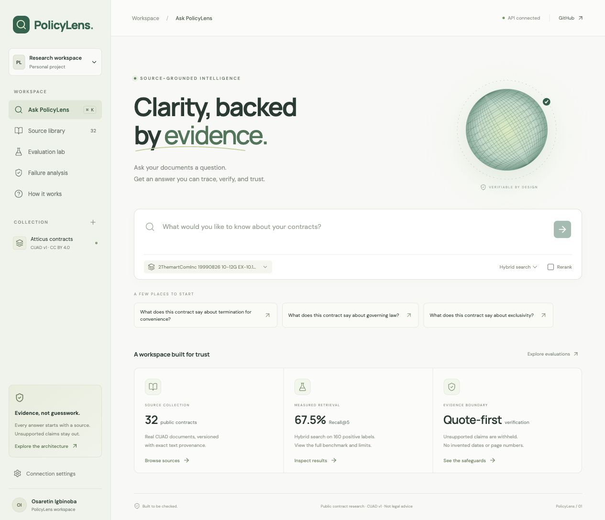
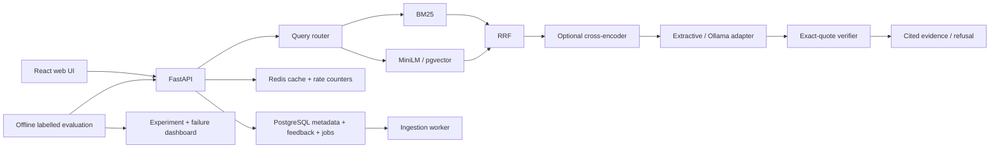

<div align="center">

# PolicyLens
### Clarity, backed by evidence.

An evidence-first contract assistant with hybrid retrieval, verified source quotations,
and a reproducible evaluation lab.

**FastAPI · React · TypeScript · PyTorch · Sentence Transformers · BM25 · pgvector · Redis**

</div>



PolicyLens answers questions about a selected public contract and makes its source
passages visible beside the answer. It compares retrieval configurations against
expert-derived CUAD labels and exposes failures instead of hiding them behind a
chat interface. The included app runs without a paid model API key.

## What works

- **Hybrid search:** BM25 + normalized MiniLM embeddings + Reciprocal Rank Fusion;
  optional cross-encoder reranking of 20 candidates.
- **Traceable answers:** retrieved-source ID validation, exact quotation checks,
  character offsets, an original-document inspector, and explicit refusals.
- **Evaluation lab:** 240 cases, four configurations, Recall@5, MRR, nDCG,
  annotated-span recall, citation precision/recall, answer token F1, abstention,
  CPU latency, and case-level failure analysis.
- **Polished web client:** responsive research workspace, source library, citation
  inspector, experiment comparison, failure filters, live session telemetry,
  verified-claim SSE, and persisted feedback.
- **Reliability:** validated schemas, API/admin authentication, rate limiting,
  bounded inference concurrency, retries/fallback, versioned TTL caches, structured
  logs, trace IDs, persistent ingestion jobs, and a separate parser/index worker.
- **Service packaging:** PostgreSQL/pgvector and Redis adapters, separate containers,
  GitHub Actions quality gates, and a read-only static preview workflow.

**Scope:** this version provides contract-scoped evidence search and verbatim answers.
It does not provide legal advice, unrestricted paraphrased synthesis, verified
historical-policy reasoning, or a comprehensive injection detector.

## Run it

Requires Python 3.11+ and Node 20.19+ or 22.12+. [Install uv](https://docs.astral.sh/uv/getting-started/installation/)
if it is not already available.

```sh
make install
make api
# In a second terminal:
make web
```

Open **http://localhost:5173**. API documentation is at **http://localhost:8000/docs**.
On first launch, MiniLM downloads and the corpus is embedded. Subsequent starts reuse
the versioned embedding cache. SQLite and local cache defaults keep setup small.

Optional reranking:

```sh
POLICYLENS_ENABLE_RERANKER=true make api
```

Optional local Ollama adapter, ingestion, Docker, and hosting instructions:
[deployment guide](docs/DEPLOYMENT.md).

## Real dataset, explicit provenance

Data was downloaded from [Kaggle’s Atticus Open Contract Dataset](https://www.kaggle.com/datasets/konradb/atticus-open-contract-dataset-aok-beta).
The original [CUAD project](https://www.atticusprojectai.org/cuad/) contains expert-annotated
commercial contracts released by The Atticus Project under CC BY 4.0.

The repository includes **32 seeded contracts and 1,726 passages**, plus:

| Evaluation slice | Cases | Label provenance |
|---|---:|---|
| Direct clause retrieval | 160 | Expert CUAD spans; programmatically rewritten questions |
| Absent/unannotated clause | 40 | CUAD empty labels; imperfect absence target |
| Adversarial, out-of-scope, ambiguous, temporal controls | 40 | Four programmatic prompts repeated across contracts |

The 200 expert-derived questions are distinct contract/clause cases. The 40 controls
are **not 40 independently authored safety prompts**. Rewrites and controls have not
been independently human-reviewed. This is a development suite, not a held-out
claim of generalization. The governing-law browser check was used to improve quote
selection, and the final suite was rerun afterward.

Expert labels are loaded only by the offline scorer. Neither ingestion nor the
answer service reads `evaluation.json`. Document text is preserved; page numbers
and dates remain unknown where the export supplies none.

[Attribution](data/ATTRIBUTION.md) · [Manifest and SHA-256 checksums](data/manifest.json)

To reproduce the corpus from the downloaded archive:

```sh
uv run python scripts/download_dataset.py
```

The downloader checks the recorded archive checksum and stops if Kaggle changes it.

## Measured results

The following table is generated from the included run, not a target or invented
example. Retrieval was **contract-scoped**, with warm CPU models, five evidence
passages, extractive generation, and uncached sequential requests. Latency includes
routing, database refresh checks, retrieval, and quote selection. Even the BM25
retrieval configuration computes dense similarity for the common refusal gate;
these are end-to-end configurations, not isolated algorithm microbenchmarks.

| Configuration | Recall@5 | MRR | Token F1 | Citation precision | Citation span recall | Abstention | p95 (ms) |
|---|---:|---:|---:|---:|---:|---:|---:|
| bm25 | 67.5% | 0.492 | 0.322 | 40.9% | 38.2% | 79.6% | 18.74 |
| dense | 51.9% | 0.364 | 0.299 | 41.0% | 30.2% | 75.0% | 17.25 |
| hybrid | 67.5% | 0.476 | 0.335 | 43.3% | 40.5% | 77.9% | 14.36 |
| hybrid+rerank | 70.6% | 0.552 | 0.338 | 43.6% | 41.9% | 78.8% | 534.19 |

**Read these correctly:**

- Recall@5 is any annotated evidence hit across the **160 positive cases**.
- Citation precision measures whether cited **chunks** overlap annotated spans;
  it does not establish that the chosen quote is a complete answer.
- Citation span recall measures gold spans reached by cited chunks.
- Token F1 is a lexical answer-overlap proxy, **not human-scored correctness**.
- Exact-quote groundedness is 100% for emitted claims because the verifier enforces
  this invariant. The much lower citation alignment shows why this alone is insufficient.
- Abstention includes imperfect absent-clause targets and repeated controls.
- p99 from 240 sequential requests is not a concurrent-load or availability claim.
- Extractive generation uses no LLM tokens or provider charges; infrastructure and
  compute costs were not measured.

Reranking increased Recall@5 from **67.5% to 70.6%**, while CPU p95 rose from **14.36 ms to 534.19 ms**. Hybrid tied BM25 on Recall@5; it did not beat every baseline. The repeated-query cache sample had p95 **1.79 ms**, a different workload. Citation alignment remains weak enough that this should be used as an inspectable evidence tool, not an autonomous policy authority.

[Full benchmark](reports/benchmark.json) · [Case-level failures](reports/failures.json)

```sh
make evaluate
```

Reruns update the report, individual case files, and recorded frontend preview.
A cache sample measures 20 repeats of one query and is reported separately.

## Architecture



[Full architecture and tradeoffs](docs/ARCHITECTURE.md)

## API

| Endpoint | Purpose |
|---|---|
| `GET /health` | Model/corpus status and dependency health |
| `GET /api/documents` | Source metadata |
| `GET /api/documents/{id}` | Original source text |
| `POST /api/query` | Verified answer or refusal |
| `POST /api/query/stream` | Phase and verified claim SSE events |
| `POST /api/feedback` | Save feedback for a recent request |
| `GET /api/experiments` | Measured offline results |
| `GET /api/metrics` | Process counters and latency window |
| `POST /api/ingestion` | Admin-only text ingestion job |
| `POST /api/ingestion/pdf` | Admin-only PDF job, max 2 MB |
| `POST /api/reindex` | Admin-only rebuild job |
| `GET /api/jobs/{id}` | Admin-only ingestion status |

```sh
curl http://localhost:8000/api/query \
  -H 'Content-Type: application/json' \
  -d '{"question":"What does this contract say about governing law?","document_id":"cuad-001","strategy":"hybrid"}'
```

Authentication uses `X-API-Key`; admin ingestion uses `X-Admin-Key`. Production mode
requires both keys. No key is embedded in the web bundle.

## Validation status

| Check | Status on the build machine |
|---|---|
| Python tests | 19 passed; 2 service integration tests skipped |
| Ruff lint / format | Passed |
| Python type checks | Passed |
| TypeScript + production frontend build | Passed |
| Live API smoke: citation, cache, refusal, SSE, metrics | Passed |
| Browser: answer, original source, feedback, dashboard | Checked |
| PostgreSQL/pgvector + Redis integration | Included in CI; not run locally |
| Docker Compose / image runtime | Not run locally; Docker unavailable |
| Ollama live inference | Adapter implemented; no local Ollama service tested |
| GitHub Actions | Published; October 10 frontend/image builds passed, backend pgvector test failed; [audit and proposed fix](docs/QUERY_WALKTHROUGH.md) |
| Public hosting | October 10 Pages deployment failed; no live deployment verified |

```sh
make check
uv run python scripts/smoke.py  # while the API is running
```

The test suite uses deterministic embedding doubles for reliability checks. The
actual benchmark uses pretrained PyTorch models. Those are distinct kinds of evidence.

## Explain and extend it

Read [Understand and explain PolicyLens](docs/EXPLAIN_IT.md) for a walkthrough,
interview questions, independent exercises, and truthful resume language.
The initial implementation was created with Codex assistance; model training and
expert annotation belong to their original authors.

Next high-value work: independent held-out contracts, human correctness labels,
semantic support verification, better abstention calibration, abandoned-job recovery,
isolated PDF parsing, full concurrent load tests, and deployment receipts.

[UI research](docs/DESIGN_REFERENCES.md) · [Deployment](docs/DEPLOYMENT.md)

Code: MIT. CUAD-derived data and recorded contract excerpts: CC BY 4.0 with attribution.
