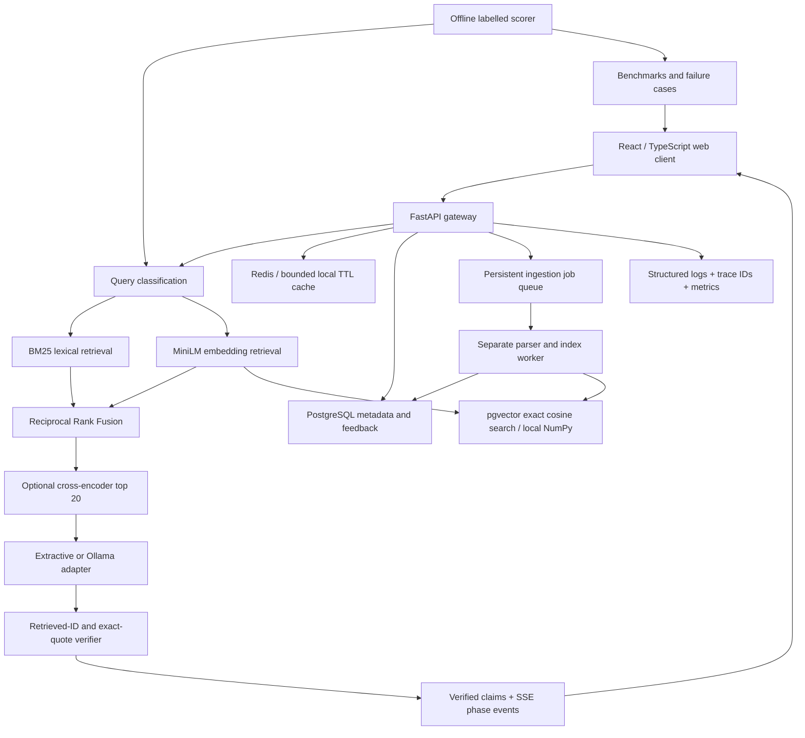

# Architecture and design decisions

PolicyLens is an evidence-first contract search system. It provides a runnable
local application and a separately packaged API, ingestion worker, database,
cache, and web client. It is a portfolio engineering system, not a certified legal
assistant or a finished production service.

## Data flow

1. The parser loads public CUAD contract text or an admin-submitted PDF/text job.
2. Chunking uses 120 words and 24 words of overlap, retaining exact start/end character offsets.
   Page/date values stay unknown when the source export does not supply them.
3. A CPU sentence-transformer embeds each chunk. Versioned NumPy caches avoid
   recomputing unchanged indexes. Production configuration also persists vectors in pgvector.
4. BM25 scores exact terms using corpus-wide document frequencies, while dense
   retrieval ranks normalized MiniLM vectors by cosine similarity.
5. Search is scoped to a selected contract for answering. The lower-level
   retriever supports corpus search; cross-document synthesis is not exposed.
6. Each ranking contributes `1 / (60 + rank)` to RRF. Its top 20 candidates may
   be rescored by the cross-encoder; five evidence passages are returned.
7. The default generator selects verbatim segments, keeping short headings with
   their supporting sentences. Phrase overlap, term overlap, dense score, and
   retrieval rank determine selection. It does not load evaluation labels.
8. The optional Ollama adapter receives untrusted evidence as data and proposes
   JSON claims. HTTP/network failures retry once; invalid output or service failure
   uses the extractive fallback.
9. All claims must cite retrieved IDs and exactly match their cited text. Any
   violation rejects the proposed answer. Verified claims stream after generation;
   unverified model tokens are never released.

## Why exact quotes?

An exact quote verifier gives a strong, testable provenance guarantee. It cannot
prove relevance, completeness, or legal applicability. That is why citation label
alignment, answer overlap, retrieval quality, and abstention are reported separately.
There is no learned entailment judge or free-form multi-document reasoning in v1.

## Persistence and process boundaries

- **Local mode:** SQLite metadata/jobs/feedback, NumPy vectors, a bounded TTL cache,
  and a local sliding-window limiter. This is the verified development path.
- **Service mode:** PostgreSQL with pgvector, Redis caching and atomic rate counters,
  and a worker claiming database jobs with `FOR UPDATE SKIP LOCKED`.
- Jobs are persistent, but v1 does not reclaim abandoned running jobs automatically.
  An operator must inspect and requeue failed/interrupted ingestion. This is a known
  availability limitation, not an exactly-once queue.
- API requests check the document fingerprint and replace the in-memory index when
  ingestion changes it. Each answer retains one index snapshot throughout retrieval.
- Old vector versions are retained for in-flight requests. Operators need a retention
  policy before running a large continually changing corpus.
- The current pgvector query uses exact search. An ANN/HNSW index should be evaluated
  separately before claiming scalable retrieval performance.

## Caching and reliability

The cache key includes the query, retrieval configuration, corpus version, provider,
model name, threshold, and pipeline revision. Responses expire after five minutes.
Cache hits get a new request ID and a fresh measured latency. No user question text
is stored in cache keys, although cached answer bodies contain public source text.

Redis outage falls back to a per-process cache and limiter. That reduces disruption,
but rate limits cease to be globally coordinated. Model inference is semaphore-bounded
and runs outside the event loop. A timed-out thread may finish computation in the
background; strict process-level cancellation requires a separate inference service.

## Security and observability boundaries

- API/admin keys are compared in constant time. Ingestion is unavailable without
  an admin key, even in demo mode. Production mode refuses startup without both keys.
- API keys are entered into the UI at runtime and held in memory. No secrets ship
  in the static preview, sample corpus, frontend bundle, or Git history.
- The router catches a documented set of injection patterns; this is not comprehensive
  detection. The exact-quote gate is an independent final boundary.
- Application logs contain request trace ID, path, status, timing, and job error class.
  They exclude question bodies, uploads, keys, IP addresses, and model prompts.
- The API returns trace IDs and process-local counters with latency percentiles.
  This is lightweight request correlation, not a full OpenTelemetry distributed trace
  exporter or Sentry integration.
- Request schemas and bounded uploads reduce accidental load. PDF parsing is not
  sandboxed; keep admin ingestion trusted until isolated parser workers are added.
- Deploy public demos read-only. The bundled corpus is public. Do not assume this
  configuration provides tenant isolation or safe handling of private employee files.

## Deferred experiments

Chunk sizes, alternate embeddings, prompt variants, human semantic correctness,
independent multi-document cases, robust temporal labels, and concurrent load tests
are extension points. Only the checked-in configurations have measured results.
